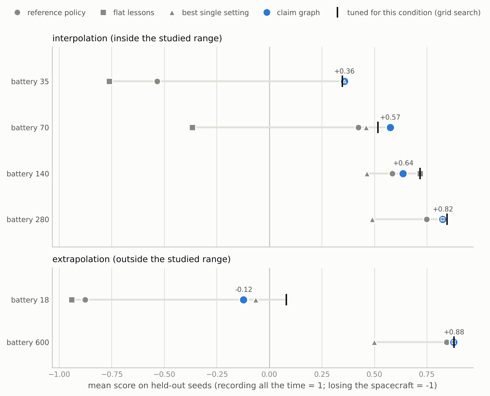

# self-evolving-agents

Agents that learn from their own runs in a simulator, with a record of where every
lesson came from.

The repository holds an implementation of
[ReasoningBank](https://arxiv.org/abs/2509.25140) (Ouyang et al., ICLR 2026;
[reference code](https://github.com/google-research/reasoning-bank)) as a baseline,
three adaptations of it to simulation environments, two extensions in which a lesson
is a *conditional claim* that has to survive controlled experiments, and an
*investigation memory* for scientific discovery tasks. The environments are
[BSK-RL](https://github.com/AVSLab/bsk_rl) spacecraft tasking on the Basilisk
simulator and [DiscoveryWorld](https://github.com/allenai/discoveryworld).

Two use cases:

- **Spacecraft operations (Basilisk).** Which control settings work for which
  spacecraft; measured without a language model (results below).
- **Scientific discovery (DiscoveryWorld).** Can an agent with frozen model weights
  improve how it investigates across tasks, so that it discovers more efficiently and
  predicts better under unseen mechanisms? The claim tested is that what transfers
  is how to investigate, not what was found. Built and verified, not yet run with a
  model: [`docs/discoveryworld.md`](docs/discoveryworld.md).

## What is established, and what is not

| | Status |
|---|---|
| The ReasoningBank baseline follows the paper | compared row by row with the paper and the reference code; ten discrepancies found, eight corrected and two kept as documented deviations; equivalence with the published system is **not** claimed. [`docs/reasoningbank-fidelity.md`](docs/reasoningbank-fidelity.md) |
| Each method is separate and runs on its own | one folder and one page per method; dependencies between folders enforced by a test. [`docs/methods/`](docs/methods/README.md) |
| The claim graph (needs no language model) | **measured** on Basilisk: two studies, a five-fold replication, one ablation; about 25,000 simulated episodes |
| Every method that needs a language model, the baseline included | **not measured.** No model was available for this work. Each is tested for its mechanics with scripted stand-ins, and the comparison that would measure it is specified in advance. [`docs/protocols/model-comparison.md`](docs/protocols/model-comparison.md), [`docs/protocols/discoveryworld.md`](docs/protocols/discoveryworld.md) |
| DiscoveryWorld's Hypothesizer baseline | ported so that its prompts are byte-identical to the released agent's (31 of 31 checked); its knowledge grader's prompt likewise |
| Model backends | Claude, any OpenAI-compatible server, Ollama, and Hugging Face models on this machine, for every component; verified against local stand-in servers and tiny local models. [`docs/models.md`](docs/models.md) |

Nothing here is a measured statement about how ReasoningBank performs in these
environments.

## The methods

| Method | Origin | What it is |
|---|---|---|
| `no_memory` | paper | the agent with no memory: the reference point |
| `reasoningbank` | paper | **the baseline**: lessons distilled from the agent's own judged trajectories, retrieved by query similarity |
| `matts` | paper, and one adaptation | several attempts per task, contrasted to distil better lessons |
| `conditioned_retrieval` | adaptation | retrieval and extraction aware of operating conditions |
| `policy_program` | adaptation | the model writes one executable rule policy per episode |
| `claim_graph` | extension | conditional claims tested by experiments the method chooses |
| `claim_memory` | extension | tested claims shown to a language-model agent as its memory |
| `hypothesizer` | DiscoveryWorld | DiscoveryWorld's own agent: hypotheses and evidence within an episode |
| `investigation_memory` | extension | evidence, conditional hypotheses and transferable strategies across tasks |

```bash
sea methods
```

## Results so far (simulator only, no language model)

Two studies on Basilisk ask which settings of a scanning spacecraft's control policy
work for which spacecraft (battery from 25 to 400 Wh; in the second study also the
solar-array area). Hypotheses were written by hand or by a simple rule; the claim
graph chose the experiments. Evaluated on conditions and seeds no experiment used:

| Battery sizes inside the studied range, first study | mean score | spacecraft lost |
|---|---|---|
| untuned reference policy | +0.305 | 19.5% |
| lessons from the reference spacecraft, applied everywhere | +0.103 | 43.0% |
| best single setting given all the evidence | +0.443 | 1.6% |
| **conditional claims** | **+0.598** | **1.6%** |
| tuning at each test condition (a reference, not a competitor) | +0.607 | 0.0% |

- Conditional claims beat the same evidence used without conditions by +0.155
  (95% interval +0.133 to +0.176) and cannot be told apart from tuning on the test
  conditions themselves (+0.009, −0.018 to +0.044).
- Lessons that are true for the reference spacecraft, applied to every spacecraft,
  lose more than twice as many spacecraft as no lessons at all.
- Repeated five times with different training seeds, the claims score +0.611 on
  average (standard deviation 0.015) and beat the single best setting every time.
  The individual claims are less stable than the score: the five runs recommend
  different settings at every held-out condition, and the size of the harm done by
  unconditional lessons varies between runs.
- Choosing experiments by probing between disagreeing results gave no measurable
  benefit over a fixed grid at this scale, and cost 21% more episodes.
- Outside the studied range the claims fall behind tuning (0.377 against 0.479), and
  in one group of the second study the unconditional lessons score slightly higher
  than the claims (0.604 against 0.587).
- One explanation was refuted although its claim holds: unloading the reaction
  wheels early helps almost everywhere, but not by protecting the wheels. It saves
  power.



Variability over repeated runs, the ablation, costs and every negative result are in
[`docs/comparison.md`](docs/comparison.md); the narrative of both studies is in
[`docs/results-bsk-battery.md`](docs/results-bsk-battery.md).

## Install

```bash
pip install -e ".[all,dev]"
```

Extras: `bsk` (Basilisk and BSK-RL), `discoveryworld`, `anthropic`, `openai` (any
OpenAI-compatible server), `ollama`, `huggingface` (transformers and
sentence-transformers; brings PyTorch, not in `all`), `gemini` (the paper's embedding
model), `plots`, `dev`. Python 3.10 or newer. On first use Basilisk downloads about
116 MB of SPICE kernels from `naif.jpl.nasa.gov`.

```bash
pytest
```

Tests that need Basilisk or DiscoveryWorld are skipped when those are not installed.

## Try it

A dry run of the baseline with a rule-based stand-in for the model. It is free and
needs no credentials; it exercises the whole loop, and its numbers mean nothing:

```bash
sea run --method reasoningbank --env toy-scan --regime nominal,small_battery --order interleaved --seeds 0:3 --llm offline-demo --out runs/dry
```

```bash
sea show runs/dry
```

Several methods on the same tasks, with paired differences against the baseline
(again with the stand-in):

```bash
sea compare run --protocol protocols/toy_dry_run.json --out runs/dry-comparison
```

Trace a memory item back to the episode it came from, or forward to the episodes
that used it:

```bash
sea prov lineage runs/dry <item-id>
```

```bash
sea prov lineage runs/dry <item-id> --down
```

Run a rule policy on real Basilisk, no model involved:

```bash
sea policy run --env bsk-scan --regime small_battery --seeds 0:8 --set charge_below=0.4
```

Reproduce the first claim study (about 30 minutes on 4 cores):

```bash
sea claims study --config studies/bsk_battery.json --out runs/bsk-battery --workers 4
```

Ask the recorded graph what it recommends for a spacecraft it has never seen:

```bash
sea claims recommend results/bsk-battery --condition battery_capacity_wh=70
```

With an Anthropic API key, the pre-registered comparison under the cheaper agent:

```bash
sea compare run --protocol protocols/scan_policy_agent.json --out runs/scan-policy-agent
```

Any other model works the same way, e.g. a local one through Ollama:

```bash
sea run --method reasoningbank --env toy-scan --seeds 0:3 --llm ollama:qwen2.5:7b --llm-option num_ctx=16384 --out runs/rb-ollama
```

The DiscoveryWorld experiment, dry run with the stand-in (a few minutes):

```bash
sea discovery run --protocol protocols/discovery_dry_run.json --out runs/discovery-dry
```

```bash
sea discovery grade runs/discovery-dry --grader offline-demo
```

```bash
sea discovery report runs/discovery-dry
```

## Documentation

| Document | Contents |
|---|---|
| [`docs/metrics.md`](docs/metrics.md) | every reported metric: definition, formula, direction, relevance, limitations |
| [`docs/discoveryworld.md`](docs/discoveryworld.md) | the DiscoveryWorld use case: question, memory types, design, measures, emergence criteria |
| [`docs/models.md`](docs/models.md) | model and embedding backends and their options |
| [`docs/reasoningbank-fidelity.md`](docs/reasoningbank-fidelity.md) | the baseline against the paper and the reference code, row by row; what can and cannot be claimed |
| [`docs/methods/`](docs/methods/README.md) | one page per method: motivation, approach, implementation, differences from the baseline, parameters, how to run it, limitations |
| [`docs/comparison.md`](docs/comparison.md) | the methods compared as designs (Part A) and by experiment (Part B) |
| [`docs/discussion.md`](docs/discussion.md) | effectiveness, failure modes, improvements, open questions |
| [`docs/reproducibility.md`](docs/reproducibility.md) | versions, seeds, commands, how recorded results are checked, known confounds |
| [`docs/protocols/`](docs/protocols/) | protocols written before the runs: the robustness experiments, the language-model comparison, the DiscoveryWorld experiment |
| [`docs/results-bsk-battery.md`](docs/results-bsk-battery.md) | the two Basilisk studies in detail, including what went wrong |
| [`docs/architecture.md`](docs/architecture.md) | modules, the environment contract, provenance |

## Layout

```
src/self_evolving_agents/
  envs/  agents/  llm/  experiments/  provenance/     shared, method-independent
  policies.py  embeddings.py  tasks.py
  methods/
    stream.py  registry.py  run.py                    the loop, and how methods are built
    no_memory/  reasoningbank/  matts/                from the paper
    conditioned_retrieval/  policy_program/           adaptations
    claim_graph/  claim_memory/                       extensions
    hypothesizer/  investigation_memory/              DiscoveryWorld baseline and extension
  compare.py                                          several methods on one stream
  discovery/                                          the DiscoveryWorld experiment and its measures
protocols/     comparison protocols (model-dependent; not yet run with a model)
studies/       claim-study configurations
results/       compact outputs of the studies run on Basilisk
tests/         310 tests
```

## Limits

- No language model has been run. Whether ReasoningBank, its adaptations, the
  claims-as-memory extension or the investigation memory help an agent in these
  environments is unknown.
- The baseline is not equivalent to the published system: different environments,
  models that do not accept the published decoding temperatures, and a different
  default embedder. The fidelity document lists every deviation.
- The claim graph has been evaluated on one simulator, one task and one family of
  policies, with conditions varied along one or two numeric variables.
- Claims are about parameters of an executable rule policy. Free-text strategies
  (DiscoveryWorld) can be stored and retrieved but not tested by experiment.
- The published sequential form of test-time scaling cannot run in episodes that end
  for good; the `restart` variant is a different procedure and is named as such.

## Attribution

Prompt texts under `methods/reasoningbank/` and `methods/matts/` are quoted from the
ReasoningBank paper and its reference implementation (Apache 2.0, Google LLC). See
`THIRD_PARTY_NOTICES.md`. This repository is MIT licensed.
