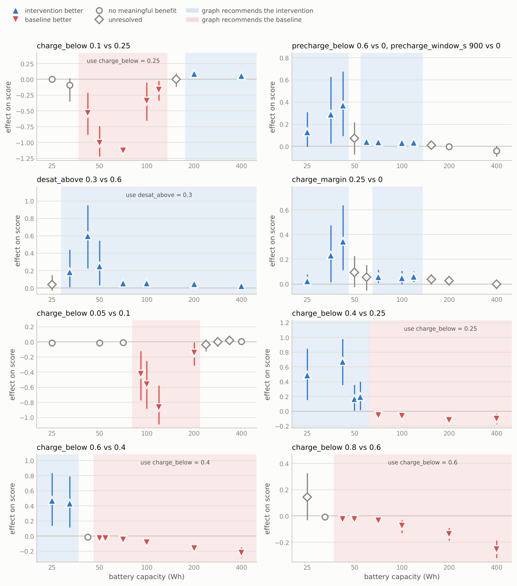
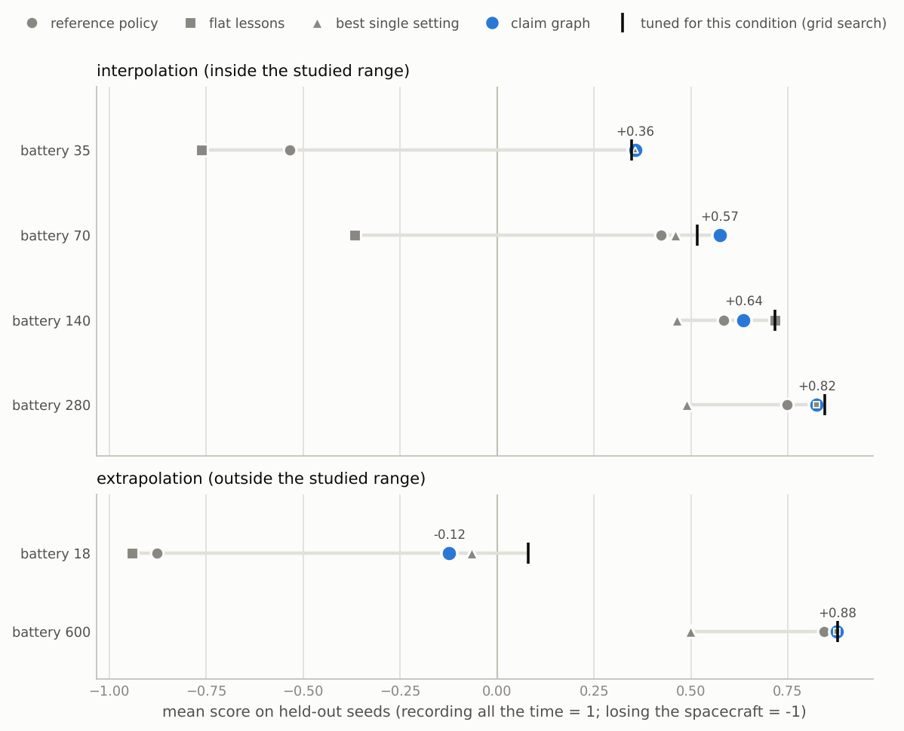
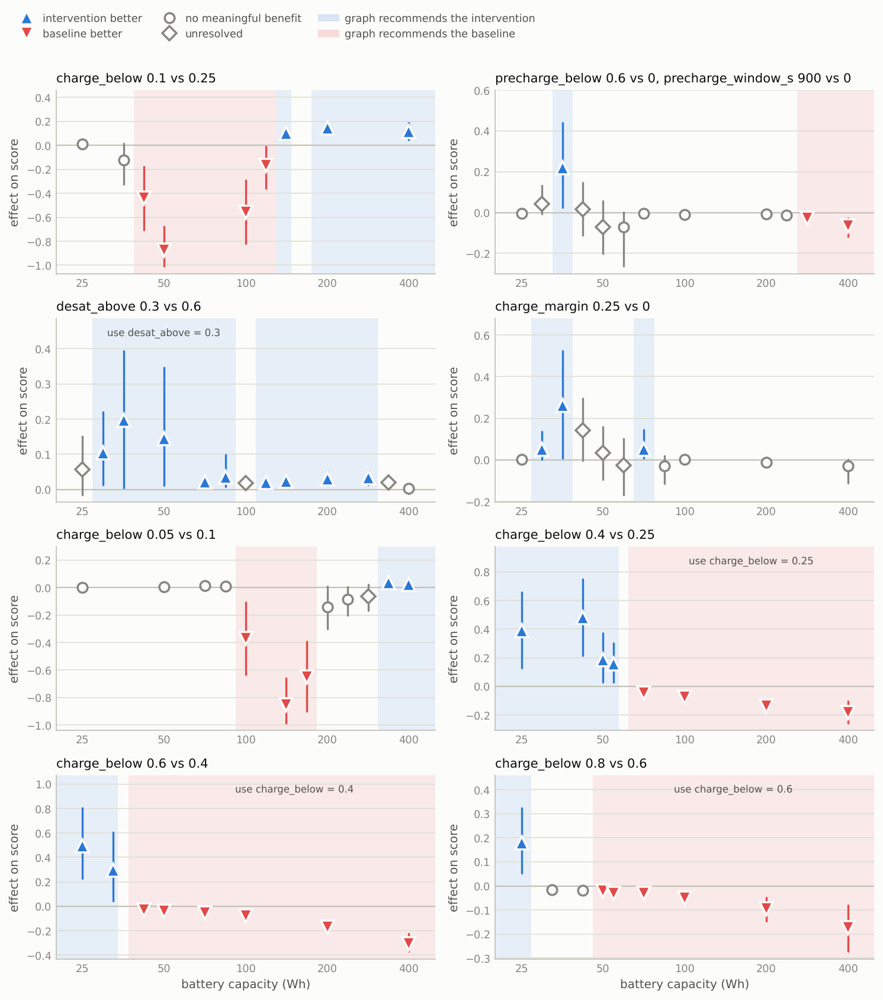
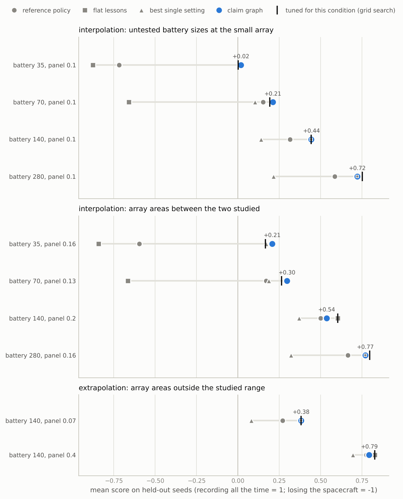

# Basilisk studies: which strategies work for which spacecraft

**Status of these results.** Everything here was run on the Basilisk simulator
through BSK-RL. No language model took part: the four starting hypotheses were
written by hand, further ones were generated by a simple rule, and the experiments
were chosen by the planner in `methods/claim_graph/loop.py`. What a language model
adds as a source of hypotheses is untested (see `protocols/model-comparison.md`).

This is the narrative account of the two studies. The systematic comparison, with the
replication over training seeds and the ablation of the experiment-selection rule, is
in [`comparison.md`](comparison.md); the metrics are defined in
[`metrics.md`](metrics.md); the method is described in
[`methods/claim_graph.md`](methods/claim_graph.md).

The question, from the project brief:

> Can an agent build an increasingly reliable, conditional model of which strategies
> work, use it to choose informative experiments, and transfer that knowledge to
> unfamiliar simulation conditions?

Short answer for this task family: yes, measurably, with the limits listed at the
end.

| On conditions and seeds never used for learning | mean score | spacecraft lost |
|---|---|---|
| untuned reference policy | +0.305 | 19.5% |
| lessons that held for the reference spacecraft, applied everywhere | +0.103 | 43.0% |
| best single setting given all the evidence | +0.443 | 1.6% |
| **conditional claims** | **+0.598** | **1.6%** |
| grid search at each test condition (yardstick) | +0.607 | 0.0% |

Four battery sizes inside the studied range, 32 seeds each. Details and the
out-of-range conditions are in [Transfer](#transfer-to-conditions-never-tested). A
second study that varies the solar-array area as well shows the same pattern
([Two conditions at once](#two-conditions-at-once)).

## Setup

**Task.** The BSK-RL nadir-scanning spacecraft over three orbits (17,100 s). At each
step it chooses one of four modes: scan (180 s), charge (120 s), downlink (60 s) or
desaturate the reaction wheels (60 s). The score of an episode is the fraction of it
spent recording data. Draining the battery or overspeeding a wheel loses the
spacecraft: the episode ends and 1 is subtracted. A seed fixes the orbit, the epoch
and every initial state, so two policies run on the same seed start identically.

**Strategies.** A rule policy with a fixed structure and named parameters:

```
1. if wheel_speed > desat_above (0.6)                                  -> desat
2. if battery < charge_below (0.25)                                    -> charge
3. if just charged, in sunlight, battery < charge_below + charge_margin (0)  -> charge
4. if in sunlight, eclipse within precharge_window_s (0) and
      battery < precharge_below (0)                                    -> charge
5. if a ground station is in view and storage > 0.05                   -> downlink
6. if storage > 0.98                                                   -> charge
   otherwise                                                           -> scan
```

A claim says that changing one of these parameters improves the score under stated
conditions. That makes every claim executable: run the policy both ways on the same
seeds.

**Condition varied.** Battery capacity, 25 to 400 Wh (the reference spacecraft has
200 Wh). The study grid is 25, 50, 100, 200, 400 Wh; the planner adds points where it
needs them.

**Hypotheses.** Four written by hand, each with one or two explanations that name a
measurable quantity:

| Hypothesis | Change | Explanation to be checked |
|---|---|---|
| A lower charge threshold collects more data | `charge_below` 0.1 instead of 0.25 | less time is spent in charge mode |
| Topping up before each eclipse improves the score | charge up to 60% in the 900 s before eclipse | the battery does not get as low; it prevents battery depletion |
| Unloading the wheels early improves the score | `desat_above` 0.3 instead of 0.6 | it keeps the wheels from their speed limit; slower wheels draw less power |
| Charging in longer blocks improves the score | `charge_margin` 0.25 instead of 0 | fewer mode switches waste less scan time |

They were written after an exploratory look at the simulator (24 seeds, none of them
used below), so they are informed guesses, not blind ones. Four more comparisons were
proposed during the study by a rule that walks a ladder of `charge_below` values
(0.05 to 0.8): try the next step when a step helped, and try a step outward when both
settings lose the spacecraft often.

**Protocol.** Every comparison is a matched-seed A/B. Seeds are added in batches (16,
32, 48) until the result is decisive; each look uses a 97.8% interval so that the
three looks together stay near 5%. The smallest effect that counts is 0.02 of score.
A result is one of: intervention better, baseline better, no meaningful benefit, or
unresolved (still inconclusive at 48 seeds).

**Cost.** 77 experiments in 21 rounds: 8 first tests, 36 boundary probes, 32 coverage
points, 1 moderator sweep. They needed 2,688 episodes, about 59 core-minutes of
simulation. Of the 76 outcome comparisons, 53 were settled with 16 seeds, 7 with 32,
and 16 went to 48. The study stopped because the planner had nothing left to propose
at the chosen resolution, with 40% of its budget unused.

## What was learned

The graph ended with 21 claims in 8 families: 13 supported, 6 superseded by narrower
ones, 2 refuted. Read as a policy, it says:

| battery capacity (Wh) | `charge_below` | `charge_margin` | `desat_above` | top up before eclipse |
|---|---|---|---|---|
| below 28.5 | 0.6 | 0.25 | · | yes |
| 28.5 to 36.9 | 0.6 | 0.25 | 0.3 | yes |
| 36.9 to 45.9 | 0.4 | 0.25 | 0.3 | yes |
| 45.9 to 54.5 | 0.4 | · | 0.3 | · |
| 54.5 to 62.1 | 0.4 | · | 0.3 | yes |
| 62.1 to 64.9 | · | · | 0.3 | yes |
| 64.9 to 135.4 | · | 0.25 | 0.3 | yes |
| 135.4 to 175.5 | · | · | 0.3 | · |
| 175.5 and above | 0.1 | · | 0.3 | · |

A dot keeps the reference value, either because nothing beat it there or because
nothing could be established. The gaps are deliberate. Between 45.9 and 54.5 Wh, for
instance, the eclipse top-up was tested at 50 Wh with 48 seeds and stayed unresolved
(+0.072, interval -0.068 to +0.215), so the graph makes no claim there even though it
is supported on both sides.



Each panel is one comparison. A marker is one matched-seed experiment with its
interval; shading is where the graph ended up recommending the intervention (blue) or
the baseline (red). Unshaded stretches carry no recommendation. The numbers are in
`results/bsk-battery/report.md`.

| Comparison | Proposed by | Supported where (Wh) | Reversed where (Wh) | No recommendation |
|---|---|---|---|---|
| `charge_below` 0.1 vs 0.25 | hand | 175.5 and above | 36.9 to 135.4 | below 36.9 (no benefit); 135.4 to 175.5 (unresolved) |
| eclipse top-up vs none | hand | below 45.9; 54.5 to 135.4 | | 175.5 and above (no benefit); 45.9 to 54.5 and 135.4 to 175.5 (unresolved) |
| `desat_above` 0.3 vs 0.6 | hand | 28.5 and above | | below 28.5 (unresolved) |
| `charge_margin` 0.25 vs 0 | hand | below 45.9; 64.9 to 135.4 | | 45.9 to 64.9 and 135.4 and above (unresolved) |
| `charge_below` 0.05 vs 0.1 | rule | nowhere | 80.5 to 218.2 | elsewhere |
| `charge_below` 0.4 vs 0.25 | rule | below 62.1 | 62.1 and above | |
| `charge_below` 0.6 vs 0.4 | rule | below 36.9 | 45.8 and above | 36.9 to 45.8 (no benefit) |
| `charge_below` 0.8 vs 0.6 | rule | nowhere | 36.9 and above | below 36.9 |

None of the four hand-written hypotheses survived as stated. All four were true
somewhere and are now claims with boundaries.

## A lesson that stopped applying

The first hypothesis is the kind of lesson an agent distils from experience on the
reference spacecraft: *a lower charge threshold collects more data.* The sequence of
experiments the planner ran on it:

| Round | Why this experiment | Battery (Wh) | Effect on score | Spacecraft lost (new / old threshold) | Result |
|---|---|---|---|---|---|
| 0 | untested hypothesis, at the reference conditions | 200 | +0.092 [+0.062, +0.120] | 0 / 0 of 16 | supported |
| 1 | grid point farthest from anything tested | 25 | +0.003 | 16 / 16 of 16 | no benefit: both lose the spacecraft |
| 2 | 25 and 200 disagree: probe between them | 70.7 | -1.130 [-1.182, -1.075] | 16 / 0 of 16 | reversed |
| 3 | 70.7 and 200 disagree | 119 | -0.168 [-0.328, -0.031] | 11 / 0 of 48 | reversed |
| 4 | 119 and 200 disagree | 154 | +0.005 [-0.105, +0.088] | 4 / 0 of 48 | unresolved |
| 4 | 25 and 70.7 disagree | 42 | -0.534 | 16 / 10 of 16 | reversed |
| 5 | 25 and 42 disagree | 32.4 | -0.091 | 16 / 15 of 16 | no benefit |

After round 0 the lesson was supported, and it is true: on the reference spacecraft
it adds nine points of score at no risk. One coverage experiment and one probe later
the graph held a case where the same change loses the spacecraft in 16 episodes of
16. Four more probes located the two edges. The original claim was superseded by two
claims that keep every counterexample: use 0.1 at 175.5 Wh and above, and use 0.25
between 36.9 and 135.4 Wh. Between 135.4 and 175.5 Wh the lower threshold records
more in most episodes and loses the spacecraft in a few, which nets out near zero;
the graph says "not established" there and recommends nothing.

The "nothing works here" rule then picked up where both thresholds failed (25 to
50 Wh) and proposed going the other way. That led to the supported claims that 0.4
beats 0.25 below 62 Wh and 0.6 beats 0.4 below 37 Wh, and to a refuted one (0.8 does
not beat 0.6).

## Explanations, judged separately from outcomes

An outcome can be right for the wrong reason. Each explanation was turned into a
prediction about a measured quantity and checked wherever its claim's outcome test
succeeded (37 checks in all).

| Claim | Explanation | Verdict | Evidence |
|---|---|---|---|
| lower charge threshold | less time is spent in charge mode | supported | 2,636 s against 4,125 s at 200 Wh; 1,268 against 2,141 at 400 Wh |
| eclipse top-up | the battery does not get as low | supported | minimum charge higher at all 5 conditions where it could be measured, e.g. 14% against 10% at 70.7 Wh |
| eclipse top-up | it prevents battery depletion | **contested** | at 59.5, 70.7, 100 and 119 Wh nobody ran flat in either arm, yet the top-up still helped; at 42 Wh it did halve the losses (5 against 10 of 16) |
| early wheel unloading | it keeps the wheels from their speed limit | **refuted** | no wheel was ever lost, in either arm, in any seed, at any of the 7 conditions |
| early wheel unloading | slower wheels draw less power, so less time is spent charging | supported | charge time lower at 5 conditions (3,319 s against 4,125 s at 200 Wh); the effect grows with the wheel speed limit as predicted: -0.070 at 1,500 rpm, +0.006 at 3,000, +0.041 at 6,000 |
| longer charging blocks | fewer mode switches waste less scan time | supported | 389 s against 896 s of unproductive scanning at 70.7 Wh |

Two things stand out. Early unloading helps almost everywhere, but the obvious
reason for it is wrong: it is an energy saving, not a safety measure. The moderator
sweep also shows where it would backfire: with a 1,500 rpm limit it costs score. And
the eclipse top-up has two regimes: for small batteries it prevents losses, for
mid-sized ones it helps without any loss being at stake, so "it prevents depletion"
is not the general reason.

Quantities that build up over an episode are compared only on seeds where both arms
finished. Otherwise an arm that loses the spacecraft early shows "less charging"
simply because it flew for less time.

"Supported" here means the measured quantity moved the way the explanation predicts.
That is consistent with the explanation and does not prove it.

## Transfer to conditions never tested

Six battery sizes that appear in no experiment: 35, 70, 140 and 280 Wh inside the
studied range, 18 and 600 Wh outside it. 32 seeds each (5000 to 5031; the study used
1000 to 1047). All methods run on the same seeds, so differences are paired.

- **reference**: the untuned policy.
- **flat**: every lesson that held at the reference conditions, applied everywhere
  (`charge_below` 0.1 and `desat_above` 0.3). This is what a memory of unconditional
  lessons amounts to.
- **pooled**: the best single setting given every experiment in the graph, applied
  everywhere. Same evidence as the claim graph, no conditioning.
- **conditional**: the claim graph.
- **grid search**: for each test condition, the best of 12 settings (`charge_below`
  by `desat_above`), chosen on 16 separate tuning seeds at that condition. A yardstick
  that sees the test condition itself. Not a ceiling: it searches two parameters, and
  the graph uses five.



**Inside the studied range** (4 conditions, 128 episodes per method):

| Method | Mean score | Spacecraft lost |
|---|---|---|
| reference | +0.305 | 19.5% |
| flat | +0.103 | 43.0% |
| pooled | +0.443 | 1.6% |
| conditional | +0.598 | 1.6% |
| grid search | +0.607 | 0.0% |

| Paired difference | Mean | 95% interval | p |
|---|---|---|---|
| conditional minus reference | +0.293 | +0.224 to +0.357 | 0.0002 |
| conditional minus flat | +0.495 | +0.427 to +0.552 | 0.0002 |
| conditional minus pooled | +0.155 | +0.133 to +0.176 | 0.0002 |
| flat minus reference | -0.202 | -0.270 to -0.131 | 0.0002 |
| grid search minus conditional | +0.009 | -0.018 to +0.044 | 0.57 |

Intervals here and below resample the 32 held-out seeds, because every condition
reuses the same seeds (`metrics.md`, section 4.2). An earlier version of this
document quoted intervals that resampled single episodes; the result files hold both,
and no conclusion drawn here differs between them.

| Battery (Wh) | reference | flat | pooled | conditional | grid search |
|---|---|---|---|---|---|
| 35 | -0.535 (75%) | -0.762 (94%) | +0.357 (6%) | +0.357 (6%) | +0.348 (0%) |
| 70 | +0.424 (3%) | -0.368 (78%) | +0.460 (0%) | +0.575 (0%) | +0.517 (0%) |
| 140 | +0.584 (0%) | +0.718 (0%) | +0.465 (0%) | +0.636 (0%) | +0.718 (0%) |
| 280 | +0.747 (0%) | +0.825 (0%) | +0.489 (0%) | +0.825 (0%) | +0.846 (0%) |

Mean score, with the share of episodes that lost the spacecraft.

- **Unconditional lessons do harm.** Applying what was learned on the reference
  spacecraft to every spacecraft is worse than learning nothing: it more than doubles
  the losses. This is the failure the claim graph exists to prevent.
- **Conditioning is what helps, not the amount of evidence.** The pooled setting had
  the same experiments to draw on. It finds the safe choice (a high charge threshold
  everywhere) and gives up a third of the score on large batteries.
- **The graph lands close to per-condition tuning** without having seen these
  conditions: 0.009 apart, an interval that includes zero.
- **Where it gave something up.** At 140 Wh the graph scores 0.636 and tuning scores
  0.718. 140 Wh falls in the stretch where the lower threshold was left unresolved,
  so the graph abstains. That is the price of not claiming what was not established,
  and here it cost 0.08.

**Outside the studied range** (18 and 600 Wh, 64 episodes per method):

| Method | Mean score | Spacecraft lost |
|---|---|---|
| reference | -0.017 | 48.4% |
| flat | -0.032 | 50.0% |
| pooled | +0.217 | 17.2% |
| conditional | +0.377 | 20.3% |
| grid search | +0.479 | 9.4% |

| Battery (Wh) | reference | flat | pooled | conditional | grid search |
|---|---|---|---|---|---|
| 18 | -0.877 (97%) | -0.941 (100%) | -0.065 (34%) | -0.123 (41%) | +0.080 (19%) |
| 600 | +0.843 (0%) | +0.877 (0%) | +0.499 (0%) | +0.877 (0%) | +0.878 (0%) |

The graph still beats the reference (+0.394, interval +0.281 to +0.501) and the
pooled setting (+0.160, +0.019 to +0.299), but the distance to tuning is now real:
+0.102 (+0.022 to +0.192, p = 0.02). All of it is at 18 Wh, below anything the study
tested. Tuning there picks a charge threshold of 0.8; the graph stops at 0.6, because
at its smallest tested battery (25 Wh) the step from 0.6 to 0.8 was unresolved
(+0.143, interval -0.028 to +0.324, 3 against 9 losses in 48). The knowledge runs out
where the experiments did.

## Do the settings work together?

Each family was tested with only its own change, against the reference policy. On
the held-out seeds, each recommended change was also run on its own:

| Battery (Wh) | reference | each change alone | all together | Finding |
|---|---|---|---|---|
| 35 | -0.535 | top-up -0.318; desat -0.393; margin -0.358; `charge_below` +0.348 | +0.357 | consistent |
| 70 | +0.424 | top-up +0.493; desat +0.517; margin +0.511 | +0.575 | consistent |
| 140 | +0.584 | desat +0.636 | +0.636 | consistent |
| 280 | +0.747 | `charge_below` +0.824; desat +0.760 | +0.825 | consistent |
| 18 | -0.877 | top-up -0.881; margin -0.869; `charge_below` -0.158 | -0.123 | consistent |
| 600 | +0.843 | `charge_below` +0.899; desat +0.830 | +0.877 | unhelpful change |

At 600 Wh early unloading scores below the reference on its own. The claim behind it
reads "28.5 Wh and above", but it was tested only up to 400 Wh, where its effect had
already shrunk from +0.057 to +0.026. Applied 1.5 times beyond its last test it no
longer holds, and it costs the combination 0.022 (interval -0.048 to -0.003) against
the lower threshold alone. An open-ended scope is an extrapolation. The graph reports
the distance to the nearest supporting test for every claim it applies; nothing in
the recommendation uses the trend of the effect sizes yet.

At 18 Wh the top-up and the longer charging blocks do nothing on their own either.
Both claims rest on marginal results at 25 Wh (+0.129 with interval +0.002 to +0.306,
and +0.024 with +0.001 to +0.075).

## The first pass, and what was changed after it

The battery study was run twice. Both runs are recorded.

The first pass (`results/bsk-battery/first-pass/`, 51 experiments) used an earlier
version of the decision rules. Reading its claim graph showed claims covering
conditions where they had not been established. The eclipse top-up, for example, was
"supported everywhere" although its tests at 200 and 400 Wh had been inconclusive:
only decisive results took part in drawing regions. Three rules were changed:

1. An interval whose upper end is below the smallest effect that counts is now "no
   meaningful benefit". It counts against the claim without supporting the reverse.
2. A comparison still inconclusive at 48 seeds is "unresolved" and gets a region of
   its own with no claim.
3. The planner closes in on both edges of an unresolved stretch.

These changes were made from the first pass's training evidence, before its held-out
scores were looked at. They did not move the headline numbers: 0.594 before and 0.598
after inside the range, 0.377 both times outside it. What changed is where the graph
commits. At 280 and 600 Wh the first pass applied the top-up and the longer charging
blocks beyond their evidence and scored 0.789 and 0.818; the corrected graph scores
0.825 and 0.877. At 140 and 18 Wh the first pass's wider claims happened to help
(0.655 against 0.636, and -0.065 against -0.123).

Later changes to the code (how the cost is counted, the composition findings, the
region table, the nearest-test check described further down) do not affect these
results: replaying the study from its episode cache with the final code gives the
same 77 experiments, the same 21 claims and the same held-out numbers.

## Two conditions at once

The second study (`studies/bsk_battery_panel.json`, results in
`results/bsk-battery-panel/`) varies battery capacity and solar-array area together:
the same eight comparisons, with the reference array (0.25 m²) and with a small one
(0.10 m²), for batteries from 25 to 400 Wh. It took 157 experiments (8 first tests,
88 boundary probes, 60 coverage points, 1 moderator sweep) and 5,648 episodes, about
2.6 hours of CPU. Most tests with the reference array are the same episodes as in the
first study, read from the cache. The graph ended with 35 claims: 26 supported, 8
superseded, 1 retired.

### What the second condition changed

| Comparison | With the 0.25 m² array | With the 0.10 m² array |
|---|---|---|
| eclipse top-up | supported from 25 to 119 Wh (unresolved at 50) | supported only at 35 Wh; no benefit from 60 to 240 Wh; **worse** at 283 and 400 Wh (-0.03, -0.06) |
| `charge_below` 0.1 vs 0.25 | supported from 200 Wh (+0.05 to +0.09); unresolved at 154 | supported from 141 Wh, with larger effects (+0.10 to +0.15) |
| `charge_below` 0.05 vs 0.1 | supported nowhere | supported at 336 and 400 Wh (+0.03, +0.02) |
| `charge_margin` 0.25 vs 0 | supported from 25 to 141 Wh (unresolved at 50 and 60) | supported at 30, 35 and 71 Wh; no benefit from 84 Wh up |
| `charge_below` 0.8 vs 0.6 | unresolved at 25 Wh | supported at 25 Wh (+0.18) |
| early wheel unloading | supported from 32 to 400 Wh | supported from 30 to 283 Wh (unresolved at 100), with smaller effects; no benefit at 400 |

The eclipse top-up is the clearest case. In the first study it was a lesson for small
and mid-sized batteries. It is also a lesson for a particular array: with the small
one it helps at a single battery size and costs score on large batteries. A reading
that fits all six rows, and the charge-time measurements behind the first claim: with
a small array charging is slow, so strategies that spend sunlit time charging return
less, and strategies that cut charging return more. That reading was not tested as
such.

The explanations came out as before, on more evidence: "keeps the wheels from their
speed limit" refuted (16 checks, no wheel lost in either arm), "slower wheels draw
less power" supported (12 checks and the moderator sweep), "prevents battery
depletion" contested (2 for, 4 against).



The same figure for the reference array is
`results/bsk-battery-panel/claims_panel_area_m2=0.25.png`.

### Transfer

Ten conditions that appear in no experiment, 32 seeds each, in three groups.



| Held-out conditions | reference | flat | pooled | conditional | grid search |
|---|---|---|---|---|---|
| untested battery sizes with the small array (35, 70, 140, 280 Wh at 0.10 m²) | +0.082 (21%) | -0.093 (46%) | +0.121 (2%) | **+0.348** (2%) | +0.347 (2%) |
| array areas between the two studied (four conditions at 0.13, 0.16 and 0.2 m²) | +0.184 (20%) | -0.034 (48%) | +0.261 (2%) | **+0.452** (2%) | +0.457 (1%) |
| array areas outside the studied range (140 Wh at 0.07 and 0.4 m²) | +0.523 (0%) | +0.604 (0%) | +0.387 (0%) | **+0.587** (0%) | +0.604 (0%) |

Mean score, with the share of episodes that lost the spacecraft.

| Paired difference | small array | between areas | outside |
|---|---|---|---|
| conditional minus reference | +0.265 [+0.220, +0.309] | +0.268 [+0.210, +0.321] | +0.064 [+0.042, +0.084] |
| conditional minus pooled | +0.226 [+0.204, +0.247] | +0.191 [+0.176, +0.207] | +0.200 [+0.181, +0.218] |
| conditional minus flat | +0.441 [+0.395, +0.479] | +0.485 [+0.437, +0.529] | -0.017 [-0.031, -0.006] |
| grid search minus conditional | -0.001 [-0.027, +0.028] | +0.005 [-0.026, +0.039] | +0.017 [+0.006, +0.031] |

The pattern of the first study repeats on a second condition: unconditional lessons
lose the spacecraft in nearly half the episodes, the pooled setting is safe and gives
up score, and the claim graph is indistinguishable from tuning on the test conditions
in the first two groups.

The third group goes the other way, slightly: the flat lessons beat the graph by
0.017 on average, all of it at 140 Wh with a 0.4 m² array (0.827 against 0.792), where
nobody loses the spacecraft. The lower charge threshold pays off there on these
seeds, and the graph withholds it: with the reference array the lower threshold was
unresolved at 154 Wh (4 spacecraft lost in 48) and reversed at 119 Wh. Here knowing
less would have scored more.

On the composition check nine of ten conditions are consistent. One is flagged (140 Wh
at 0.2 m²: unloading and longer charging blocks together score 0.536, unloading alone
0.549); the paired difference is -0.014 with an interval from -0.050 to +0.019, so it
cannot be told from noise.

### When does a claim apply? A rule that changed during this study

This is the part of the work where the method was still moving, so the order of
events matters.

1. **While the experiments ran**, a claim applied wherever its scope contained the
   conditions.
2. **Reading the finished graph**, before any held-out result existed, showed scopes
   reaching across array areas. A scope is a box around tests that agree. The
   lower-threshold claim covered 130 to 147 Wh at *every* array area on the strength
   of one test at 141 Wh with the small array, although with the reference array the
   neighbouring tests said unresolved and reversed. A check was added: the nearest
   test of the comparison must agree with the claim. Along one variable this check
   never bites, and the first study re-evaluates to identical numbers.
3. **The first held-out evaluation** then showed that the check, as written, also
   blocked a claim whose nearest test agreed with it but belonged to a neighbouring
   region. Early wheel unloading was withheld at two conditions for that reason. The
   check was corrected to compare verdicts. This correction came after held-out
   numbers had been seen.

| Conditional method, mean held-out score | scope only (1) | check as first written (2) | check as corrected (3) |
|---|---|---|---|
| small array | 0.348 | 0.348 | 0.348 |
| between areas | 0.477 | 0.449 | 0.452 |
| outside | 0.607 | 0.583 | 0.587 |

The three rules differ at two conditions only, both at 140 Wh with the larger arrays,
and at both the check lowers the score (0.536 against 0.636, and 0.792 against
0.833). It removes exactly the lower threshold discussed above. The check stays the
default, because what it relies on was sound: the tests with that array did not
establish the lower threshold, and 32 seeds without a loss do not show it is safe
when 4 of 48 were lost a little higher up. But the held-out data do not favour it,
and it is a judgment call. `results/bsk-battery-panel/applicability-rules.json` has
the numbers, and `first-evaluation/` keeps the evaluation as it first ran.

## What this shows and what it does not

It shows, on a real simulator:

- A lesson that is true where it was learned and dangerous elsewhere was caught by
  the second experiment after it was first supported, and bounded by four more.
- The experiments were chosen by the state of the graph: 36 of 77 were probes between
  two results that disagreed.
- Of six explanations, one was refuted and one is contested, although the claims
  they were attached to hold.
- Using the result as a conditional policy transfers to untested battery sizes about
  as well as tuning on them, and clearly better than using the same evidence without
  conditions. The same holds with a second condition varied at once.
- Varying a second condition turned a lesson about battery size into a lesson about
  battery size and array area, without anyone telling the system which claims the
  array would matter for.

It does not show:

- **Anything about language models.** The hypotheses here came from a person and a
  ladder rule. Whether a model proposes better ones, and whether claims rendered as
  memory help a model that acts step by step, has not been run.
- **Transfer across kinds of difference.** The held-out conditions differ in the one
  variable that was studied. A different orbit regime, payload or failure physics is
  a different question.
- **That every claim is right.** 76 comparisons at roughly 5% each will include a few
  false findings, and the correction used controls each sequential test, not the
  whole set. The marginal results at 25 Wh are candidates. Intervals from 16 seeds
  are approximate.
- **A general optimiser.** The policy has a fixed structure and seven parameters, and
  each change is tested against the reference policy one at a time. Interactions are
  only screened afterwards.
- **That caution always pays.** Twice the graph declined to recommend something that
  would have scored better on the held-out seeds (at 140 Wh in both studies). Whether
  abstaining on unresolved evidence is right depends on what a lost spacecraft costs
  compared with a few points of score, and that trade-off is fixed here by the
  scoring rule, not chosen.
- **A settled method.** The decision rules changed three times in response to what
  the studies showed, once after held-out numbers had been seen. Each change is
  recorded above with the numbers before and after.

## Reproduce

About 15 minutes for the study and 15 for the evaluation on four cores:

```bash
sea claims study --config studies/bsk_battery.json --out runs/bsk-battery --workers 4
```

The two-variable study takes about 40 minutes plus 35 for its evaluation:

```bash
sea claims study --config studies/bsk_battery_panel.json --out runs/bsk-battery-panel --workers 4
```

Seeds are fixed, so the experiments and claims come out the same; claim identifiers
are random. An interrupted run continues from its episode cache when started again
with the same command.

Ask the recorded graph about a spacecraft it has not seen:

```bash
sea claims recommend results/bsk-battery --condition battery_capacity_wh=70
```

Files in `results/bsk-battery/`: `report.md` (every comparison with its evidence,
the revision history, the held-out tables), `graph.json` (claims, evidence,
relations, log), `experiments.jsonl` (what was run and why), `transfer.json`,
`composition.json`, `study.json`, `config.json`, and the two figures.
